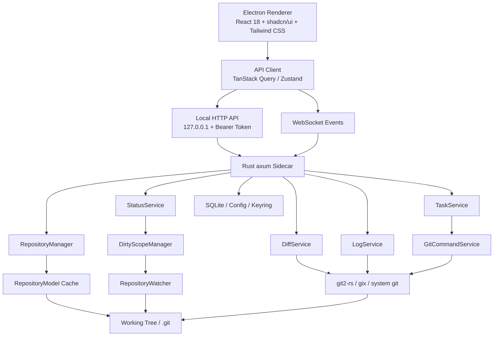

# GitCrest Git 引擎架构方案

本文参考 `git-management-implementation-analysis.md` 和 `git-management-concrete-implementation.md` 中对 IntelliJ Community Git 管理实现的总结，但只吸收 Git 管理的设计思想，不复制 IntelliJ 的通用 VCS 平台、IDE 文档模型和插件扩展体系。

GitCrest 是专注于 Git 的桌面客户端，因此架构目标不是“支持所有 VCS”，而是把 Git 的状态、操作、历史、Diff 和安全边界做深、做稳、做快。

## 1. 设计目标

1. **Git 语义优先**：不重新发明 Git 算法，核心语义以真实 Git 行为为准。
2. **状态缓存优先**：UI 高频读取仓库状态时走内存模型，强一致场景显式刷新。
3. **增量刷新优先**：文件变化、`.git` service file 变化和远程状态变化都进入 dirty scope，避免每次全仓库扫描。
4. **写操作串行化**：checkout、merge、rebase、commit、reset、push 等可能修改 index、refs 或 working tree 的操作必须按仓库串行执行。
5. **任务化执行**：长耗时 Git 操作统一进入任务系统，支持进度、日志、取消、失败恢复和 UI 通知。
6. **前后端边界清晰**：Electron/React 只负责展示和交互，Rust axum 服务负责 Git 状态模型、命令编排和文件系统访问。
7. **危险操作可解释**：force push、reset、clean、rebase、丢弃更改等操作必须有预检、影响范围、确认和尽可能的恢复点。

## 2. 总体架构



架构分为四层：

| 层级 | 职责 |
|---|---|
| 展示层 | React 18 负责仓库列表、工作区、提交、分支、Diff、提交图和任务面板 |
| API 层 | axum 提供 HTTP JSON API 与 WebSocket 事件，隔离前端与本地文件系统 |
| Git 应用层 | 仓库状态、dirty scope、任务编排、提交、分支、远程、Diff、Log 等领域服务 |
| Git 执行层 | 优先使用 `git2-rs` / `gix` 读取结构化数据，复杂或兼容性敏感操作回退 system git |

## 3. 核心设计思想

### 3.1 Repository 是状态缓存，不是 Git 本身

GitCrest 后端维护 `RepositoryModel`，用于缓存 UI 高频读取的仓库状态：

- 仓库根目录、`.git` 目录、worktree 目录
- 当前分支、当前 HEAD revision、detached HEAD 状态
- repository state：normal、merging、rebasing、cherry-picking、bisecting
- local branches、remote branches、tags、remotes
- upstream / tracking 信息
- submodule、worktree、shallow clone、hooks 信息
- 最近一次刷新时间和刷新原因

普通 UI 查询读取缓存；执行提交、切分支、rebase、push 前，必须调用显式刷新，保证关键操作看到足够新的状态。

### 3.2 `.git` 文件监听驱动状态刷新

`RepositoryWatcher` 监听 working tree 和 `.git` 关键文件变化，把变化转换成明确的刷新原因：

| 变化 | 刷新动作 |
|---|---|
| `.git/config` | 刷新 remotes、tracking、hooks、submodule 配置 |
| `HEAD` | 刷新当前分支、HEAD revision、提交图首屏 |
| `refs/heads/*` / `refs/remotes/*` | 刷新分支、上游关系、提交图 refs |
| `packed-refs` | 刷新 branches、tags、log refs |
| `index` | 标记工作区 dirty，刷新 staged/unstaged 状态 |
| `MERGE_HEAD` / `REBASE_HEAD` / rebase 目录 | 刷新 repository state 和冲突状态 |
| `.gitignore` / `.git/info/exclude` | 刷新 ignored/untracked 状态 |
| `.git/worktrees` | 刷新 worktree 列表 |

这个模型让 GitCrest 不需要在 UI 每次切换时暴力扫描仓库，而是通过事件逐步维护最终一致的状态。

### 3.3 Dirty Scope 增量刷新工作区

工作区状态不直接“全量 status 一把梭”。后端维护 `DirtyScopeManager`：

1. 文件系统 watcher、Git 操作结果、用户主动刷新都会提交 dirty path。
2. Dirty path 按 repository 分组，并合并相邻路径。
3. `StatusService` 获取 dirty scope 快照并执行增量刷新。
4. 刷新期间新增的 dirty path 进入下一轮，避免互相覆盖。
5. 遇到 rename、submodule、ignored 规则变化等边界场景时升级为目录级或全仓库刷新。

UI 展示的工作区状态来自 `StatusSnapshot`：

- staged
- unstaged
- untracked
- ignored
- conflicted
- renamed / copied
- submodule changed
- file mode changed

### 3.4 Git 命令由统一 CommandService 执行

所有 Git 操作必须通过 `GitCommandService`，不允许业务服务自行拼接并启动进程。

`GitCommandService` 负责：

- 命令类型：read、read with optional lock、write
- 仓库级写锁：写操作串行，读操作尽量并行
- system git 路径、版本检查和能力探测
- 认证环境、SSH agent、credential helper、askpass
- stdout/stderr 收集和结构化错误分类
- 超时、取消、进度解析
- 命令审计日志和调试 trace

推荐执行策略：

| 场景 | 推荐实现 |
|---|---|
| 读取对象、refs、commit metadata | `gix` 优先 |
| status、diff、blame、基础仓库读写 | `git2-rs` 优先 |
| push、fetch、clone、credential、复杂 rebase/merge | system git 优先 |
| 兼容性不确定或用户环境强相关操作 | system git 兜底 |

## 4. 后端模块划分

### 4.1 RepositoryManager

负责仓库生命周期：

- 打开本地仓库、clone 后注册仓库
- 发现 `.git`、worktree、submodule 和 nested repository
- 为仓库分配稳定 `repoId`
- 维护 `repoId -> RepositoryModel`
- 仓库关闭、移动、失效和重新加载
- 多仓库场景下的排序与依赖关系，例如 parent repo 与 submodule

### 4.2 RepositoryReader

负责从磁盘读取 Git 元数据：

- 解析 `.git` 文件或目录
- 读取 `HEAD`、refs、packed-refs
- 读取 config、remotes、tracking
- 判断 merge/rebase/cherry-pick/bisect 状态
- 读取 shallow、hooks、submodules、worktrees

它只做读取和解析，不触发 UI 事件，也不执行高层工作流。

### 4.3 StatusService

负责工作区状态：

- 响应 dirty scope
- 维护 `StatusSnapshot`
- 提供 staged/unstaged/untracked/conflicted 文件列表
- 支持按目录、文件类型、状态过滤
- 为前端 Diff 和 Commit 面板提供稳定数据模型

MVP 可以先实现全仓库 status，再逐步替换为 dirty scope 增量刷新。接口需要从第一天就按增量刷新设计。

### 4.4 TaskService

所有长耗时操作都进入 TaskService：

- clone、fetch、pull、push
- checkout、create branch、delete branch
- merge、rebase、cherry-pick、revert、reset
- commit、amend、stash、clean

Task 需要包含：

- task id、repo id、类型、状态
- 当前步骤、进度、可读日志
- 可取消标记
- 风险级别
- 失败原因和恢复建议
- 完成后触发的 repository/status/log 刷新

### 4.5 CommitService

CommitService 的关键不是简单执行 `git commit -a`，而是精确控制 index：

- 支持只提交选中文件
- 支持只提交选中 hunk 或选中行
- 提交前保护用户原本已经 staged、但本次未选择提交的内容
- commit 完成后恢复 index 状态
- 支持 amend、sign-off、GPG/SSH signing、跳过 hooks
- 支持 commit message 生成和模板填充

这一点是 Git 客户端的核心体验差异。GitCrest 需要从 MVP 就避免“误提交不该提交的 staged 内容”。

### 4.6 BranchService

BranchService 负责分支工作流编排：

- checkout existing branch / remote branch / commit
- create、rename、delete local branch
- delete remote branch
- merge、rebase、cherry-pick
- checkout 前预检未提交更改和冲突状态
- 多仓库操作的部分成功、失败回滚和用户提示

具体 Git 命令由 CommandService 执行，BranchService 只负责业务流程和状态刷新。

### 4.7 RemoteService

RemoteService 负责远程操作：

- fetch、pull、push
- 设置 upstream
- force-with-lease 优先于 force
- tag push 策略
- remote progress 解析
- 认证失败、网络失败、non-fast-forward 等错误归类

危险远程操作必须返回影响范围，例如将要推送的 commit、将被覆盖的远程引用、是否启用 force-with-lease。

### 4.8 LogService

LogService 负责提交历史和提交图：

- 首屏优先读取 `HEAD --branches --remotes`
- 默认不全量读取 tags，避免 tag 很多时拖慢首屏
- 后台补充 refs、tags 和更多 commit metadata
- UI 不可见时延迟刷新，用户切到 Log 页面时再追平
- 支持按 author、path、branch、message、date 过滤

提交图数据需要独立缓存，避免工作区 status 刷新影响 Log 首屏性能。

### 4.9 DiffService

DiffService 负责生成前端可渲染的结构化 Diff：

- working tree vs index
- index vs HEAD
- commit vs parent
- branch vs branch
- file history diff
- conflict 三方 diff

Diff 输出建议使用统一 `DiffDocument`：

- 文件级 metadata
- hunks
- line changes
- inline changes
- rename/copy 信息
- binary/LFS/submodule 特殊状态
- 可选 tree-sitter 语义增强信息

## 5. API 与事件模型

### 5.1 HTTP API

HTTP API 只暴露领域动作，不暴露任意 shell 执行能力。

| API | 用途 |
|---|---|
| `GET /repositories` | 获取仓库列表 |
| `POST /repositories/open` | 打开本地仓库 |
| `GET /repositories/{repoId}` | 获取仓库状态缓存 |
| `POST /repositories/{repoId}/refresh` | 显式刷新仓库状态 |
| `GET /repositories/{repoId}/status` | 获取工作区状态 |
| `GET /repositories/{repoId}/diff` | 获取结构化 Diff |
| `GET /repositories/{repoId}/log` | 获取提交历史 |
| `POST /repositories/{repoId}/commit` | 提交选中内容 |
| `POST /repositories/{repoId}/branches/checkout` | 切换分支 |
| `POST /repositories/{repoId}/remotes/fetch` | fetch |
| `POST /repositories/{repoId}/remotes/push` | push |
| `GET /tasks` | 获取任务列表 |
| `POST /tasks/{taskId}/cancel` | 取消任务 |

### 5.2 WebSocket Events

后端通过 WebSocket 推送事件：

- `repository.updated`
- `status.changed`
- `log.refsChanged`
- `task.started`
- `task.progress`
- `task.completed`
- `task.failed`
- `auth.required`
- `danger.confirmationRequired`

前端用 TanStack Query 维护服务端状态缓存，用 WebSocket 事件触发精准 invalidation。

## 6. 关键流程

### 6.1 打开仓库

```text
open repository
  -> RepositoryManager validates path
  -> RepositoryReader finds .git / worktree metadata
  -> create RepositoryModel
  -> install RepositoryWatcher
  -> initial refresh repo info
  -> initial status snapshot
  -> emit repository.updated + status.changed
```

### 6.2 文件变化到工作区刷新

```text
file changed
  -> RepositoryWatcher receives event
  -> DirtyScopeManager marks path dirty
  -> StatusService consumes dirty snapshot
  -> Git status refresh
  -> update StatusSnapshot
  -> emit status.changed
  -> frontend invalidates status/diff queries
```

### 6.3 提交选中 hunk

```text
commit selected hunks
  -> CommitService refreshes repository state
  -> validate merge/rebase/conflict state
  -> save current index state
  -> stage selected hunks only
  -> run git commit
  -> restore unrelated staged state
  -> refresh repository/status/log
  -> emit task.completed + status.changed + log.refsChanged
```

### 6.4 切换分支

```text
checkout branch
  -> BranchService preflight working tree
  -> create task
  -> acquire repo write lock
  -> run git checkout/switch
  -> refresh RepositoryModel
  -> mark root dirty
  -> refresh status and log refs
  -> emit repository.updated + status.changed
```

## 7. 一致性与并发策略

1. **RepositoryModel 是最终一致缓存**：UI 可以快速读取，但关键写操作前必须强制刷新。
2. **按实际写资源串行**：同一工作树的写操作串行；共享 common Git directory 的 linked worktree 还须协调共享资源，不能仅按 `repoId` 分锁。资源独立的仓库可以并行，锁范围和获取顺序遵循 [后端开发规范](14-backend-development-guidelines.md) 第 6 节。
3. **读操作尽量并行**：log、diff、status 可以并行，但需要避免和写操作读到互相冲突的中间状态。
4. **任务完成后显式刷新**：Git 写操作结束后必须刷新 repository、status 和必要的 log refs。
5. **事件可合并**：短时间内大量文件变更需要 debounce 和 coalesce，避免 UI 被事件淹没。
6. **前端不假设事件完整**：WebSocket 断线重连后，前端必须主动重新拉取当前仓库状态。

## 8. 安全边界

1. Electron renderer 不能直接访问文件系统和 shell。
2. Rust sidecar 只监听 `127.0.0.1`，使用每次启动生成的 Bearer token。
3. API 使用 `repoId` 访问仓库，避免前端任意传路径执行敏感操作。
4. 危险操作必须经过后端预检，并返回可展示的影响范围。
5. `reset --hard`、`clean -fd`、force push、delete remote branch 等操作需要二次确认。
6. 凭据存储使用系统 keyring，不写入项目配置或日志。
7. 命令日志默认脱敏 remote URL、token、用户名密码。

## 9. MVP 实施顺序

1. **Repository 基座**：RepositoryManager、RepositoryReader、RepositoryModel、repoId。
2. **axum API 与鉴权**：HTTP API、WebSocket、启动 token、Electron preload API。
3. **Status 基座**：全仓库 status、StatusSnapshot、工作区列表、基础 Diff。
4. **Command 与 Task**：统一 GitCommandService、任务模型、进度、取消、错误分类。
5. **Commit 与 Branch**：选中文件提交、基础 hunk 提交、checkout/create/delete branch。
6. **Remote**：fetch、pull、push、force-with-lease、安全确认。
7. **Log 与 Diff 优化**：提交图首屏、后台补全、结构化 Diff、语义增强。
8. **Dirty Scope 增量刷新**：在 MVP 可用后逐步替换全量 status 刷新。

## 10. 不采用的 IntelliJ 设计

GitCrest 不需要照搬以下能力：

- 通用 VCS 平台抽象，例如同时支持 SVN、Mercurial、Perforce。
- IDE 文档模型、VFS 模型和 ChangeList 平台复杂度。
- IntelliJ extension point 体系。
- 面向大型 IDE 插件生态的 provider/environment 注册机制。
- 完整多模块项目映射系统。

GitCrest 只保留这些思想：

- 仓库状态模型和缓存。
- `.git` 变化监听。
- dirty scope 增量刷新。
- native Git / Git library 优先，不重写 Git 算法。
- 写命令串行化。
- Git 操作任务化。
- Commit 时精确控制 index。
- Log 首屏性能优先。

## 11. 推荐技术落点

| 模块 | 推荐技术 |
|---|---|
| HTTP 服务 | `axum` |
| 异步运行时 | `tokio` |
| API 序列化 | `serde` / `serde_json` |
| Git 结构化读取 | `gix` |
| Git 仓库基础操作 | `git2-rs` |
| Git 兼容性兜底 | system git |
| 文件监听 | `notify` |
| 数据存储 | `rusqlite` 或 `sqlx` + SQLite |
| 凭据存储 | `keyring` |
| Diff 算法 | `similar` |
| 语义解析 | `tree-sitter` |
| 日志追踪 | `tracing` |

## 12. 总结

GitCrest 的 Git 架构应该是“Rust Git 引擎 + 仓库状态缓存 + 任务编排 + 事件驱动 UI”的组合。

IntelliJ 的经验说明，一个优秀 Git 客户端的核心不是把 Git 命令包一层按钮，而是把 Git 的状态变化、index、refs、working tree、远程交互和用户意图组织成可靠、可解释、可恢复的工作流。GitCrest 应该把这套能力做成自己的 Git 引擎，而不是做成通用 IDE VCS 平台。
