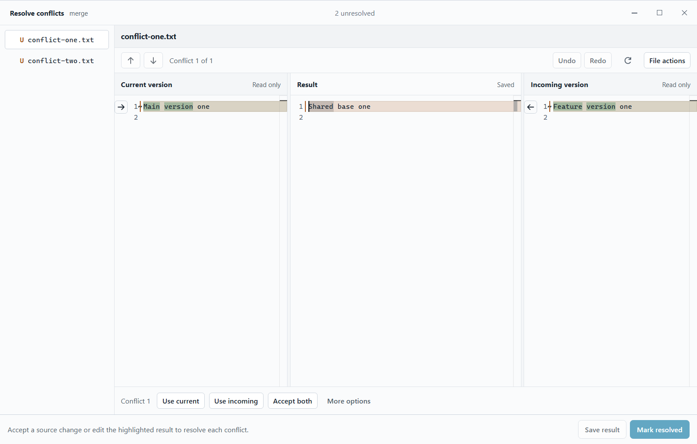

# Clean result and source arrows

Date: 2026-11-01. This refinement supersedes the earlier requirement to show Git markers inside the result.

- Loaded Git conflict markers are not displayed in the editable result. Pending regions use ancestor text as a starting point; where unavailable, current-side text remains a pending proposal.
- Source panes highlight pending regions. Their merge arrows accept that side into the result and disappear after acceptance. Undo restores the pending decision and arrows; Redo accepts it again.
- Manual editing of a highlighted result region supplies the composed output, including both sides' changes on the same line. Edits outside that region preserve unrelated pending decisions.
- Pending decisions are projected from an internal draft, preserving the existing unresolved Save draft/reopen behavior. After all decisions are resolved, the saved text equals the clean visible output. A clean-looking proposal alone cannot enable completion.
- The editor keeps one undo history. Decision snapshots follow editor version identities, including acceptance with unchanged visible text. Keyboard-accessible arrows live outside Monaco's accessibility-hidden decoration layer and follow source scrolling.

Implementation: `conflict-presentation.ts` owns projection, edit mapping and source locations; `ConflictResultEditor.tsx` adapts the clean result to the existing guarded workflow; `ConflictEditor.tsx` renders source arrow rails. Unmapped source ranges retain selected-conflict controls rather than guessed arrows.

Verification:

| Check | Result |
|---|---|
| `pnpm build` | TypeScript and Electron build passed |
| `pnpm test` | 754 tests in 124 files passed |
| `pnpm test:e2e -- tests/e2e/conflict-workflow.test.ts` | Four real Git workflow tests passed, including source arrows, manual composition, undo, saving/staging and exact EOL preservation |
| `node scripts/review-conflict-resolver.mjs` | Clean-result matrix: 1280×816, 960×700, 800×600 × English/Chinese × light/dark; footer remains visible |
| Real editor interactions | Acceptance removes arrows; Undo/Redo restore decision state; manual composition works; unchanged-text acceptance is undoable; loaded markers stay hidden |
| Source detector | Zero findings across the three changed editor/workspace components |
| Frontend boundaries and `git diff --check` | Passed |

Local logs are `.review/conflict-resolver/arrow-*.log`; the full screenshot matrix and JSON are `.review/conflict-arrows/`. [Machine-readable refinement evidence](conflict-resolver-clean-result-verification.json) includes source fingerprints. Earlier handoff, failure/recovery and large-file evidence is retained in the [baseline record](conflict-resolver-uiux-validation.md), with focused unit coverage retained in the current suite.

Limitations remain: Windows runtime verification; existing core source-size cap; ambiguous mappings use secondary controls; no complete screen-reader certification. Directly typing malformed marker syntax still triggers the existing review warning.
