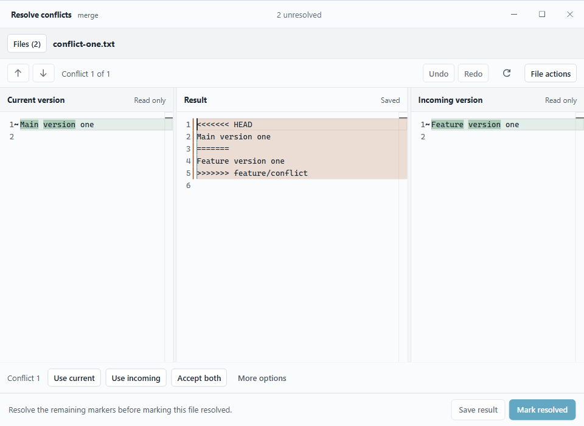
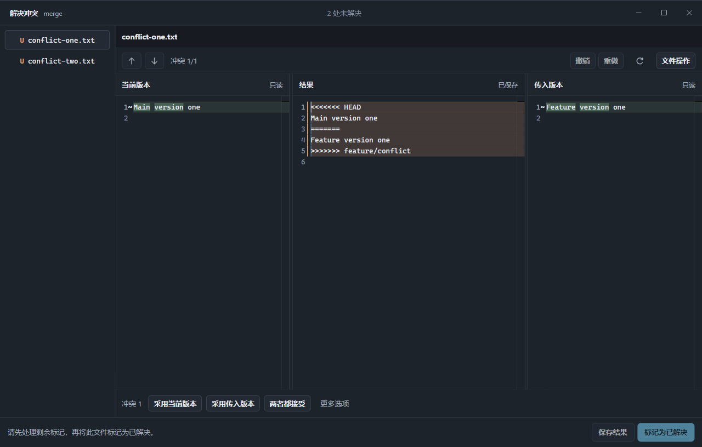
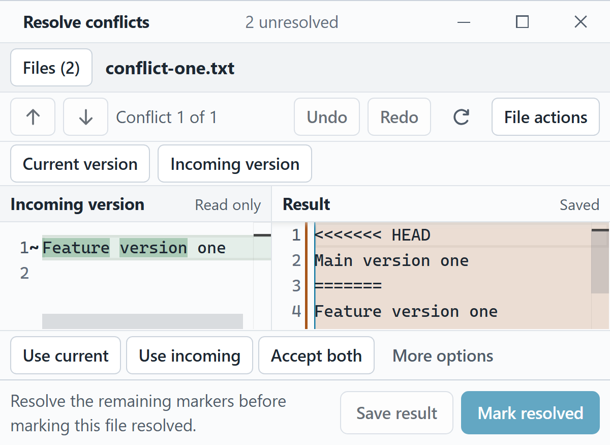

# Conflict resolver UI/UX validation

Date: 2026-11-01. Platform: Windows, Electron. Scope: all five findings in the [implementation guide](../conflict-resolver-uiux-implementation-guide.md). This is the baseline validation before the subsequent clean-result and source-arrow refinement. See [current refinement validation](conflict-resolver-clean-result-validation.md).

The baseline implemented Current version | editable Result | Incoming version, with one editor history for typing and programmatic changes. The subsequent refinement projects Git markers out of this result and adds source arrows. The original neutral visual system and existing backend merge algorithms remain in use.

## Five findings

| Finding | Result | Evidence |
|---|---|---|
| Save controls below the viewport | Bounded shell with a persistent footer; editors scroll internally | Eight baseline geometry checks show footer within viewport and document height equal to viewport; 200% zoom also keeps footer reachable |
| Competing result representations | One editable center result; base and unapplied suggestions remain secondary | Rendered screenshots; single-result unit assertion; real editor acceptance and undo checks |
| Competing action scopes | Selected-conflict choices lead; whole-file operations live in File actions | Rendered matrix; reconstruction/Smart Merge/ignore tests; dirty replacement confirmation and cancellation checks |
| Lost keyboard focus after acceptance | Focus follows the next unresolved result range and stays in result after the last choice | Real Electron keyboard and repeated-conflict checks; shared typing/acceptance undo sequence; Tab exits editor |
| Manual completion handoff | Return to Task Center focuses the matching task with acknowledged delivery | Real main-window recreation, missing-task and matched-task checks; task remains waiting for input; sender validation/timeout/queue unit tests |

## Requirements and safeguards

| Guide sections | Implementation and verification |
|---|---|
| 3–4: layout and authoritative result | Responsive `ConflictWorkspace` and one `ConflictEditor` model. Resizable panes, compact Files drawer, below-860 source selection, independent source scrolling, and explicit ambiguous-source mapping. Baseline captures plus narrow and zoom checks. |
| 5: range safety and navigation | Choices validate the current raw range; malformed markers prevent completion. Repeated blocks, absent/ambiguous mapping and empty results have focused model coverage. Real keyboard choices preserve unrelated text. |
| 6: replacement and retained capabilities | Shared dirty-draft confirmation starts on Keep edits. File menu retains non-conflicting reconstruction, full-side replacement, Smart Merge and AI. AI retains the existing consent, save-first and revision checks; accepted proposals enter the editor transaction path. |
| 7: saving and recovery | Save draft remains distinct from staging. Save-and-stage uses the confirmed saved revision; save failure prevents staging; staging failure leaves a saved retryable result. Unit tests cover cancellation, failures, restricted access, binary/deletion choices and core restart, including a recovered draft whose conflict disappeared. |
| 8: focus and undo | Monaco owns text history; ordinary typing and conflict acceptance undo in order. Saving keeps history. Raw EOL signatures follow editor versions. Real Git E2E covers CRLF, mixed endings, missing EOF newline, save, undo after save and staging. Dialog/menu focus returns to trigger or a live result/completion fallback. |
| 9: Task Center | Main derives identity from registered conflict context; the destination alone acknowledges correlated requests. Queues survive main renderer startup/recreation. Unit coverage includes sender rejection, deduplication, delivery ordering, source closure and timeout. Real Electron verifies matching/missing tasks and unchanged restricted capability. No Git continuation is executed by handoff. |
| 10: visual quality and localization | English/Chinese × light/dark × 1280×816 and 960×700, including populated, multiple-conflict, dirty, replacement, save-error and completion states. Minimum measured primary contrast 4.77:1; source line numbers 4.93:1. Shared semantic colors and controls retained. |
| 11–13: delivery and checks | Bounded shell, editor/navigation, file actions, state machine, handoff and verification slices are present. `DESIGN.md` records the resulting resolver conventions. Checks below pass. |

## Checks

| Command | Result |
|---|---|
| `pnpm build` | Passed TypeScript and Electron production build; existing dependency eval/chunk-size warnings remain |
| `pnpm test` | 747 tests in 123 files passed |
| `pnpm test:e2e -- tests/e2e/conflict-workflow.test.ts` | All four real conflict workflow tests passed |
| `node scripts/review-conflict-resolver.mjs` | Passed rendered, geometry, keyboard, editor, replacement, save/stage and handoff checks; no renderer errors |
| `pnpm frontend:boundaries` | Passed |
| `git diff --check` | Passed; Git reports line-ending conversion notices |
| Impeccable changed-markup source scan | Zero findings; this supplements the rendered checks |

The owned Electron runner uses disposable repositories/profiles. It tests a 798,898-byte, 30,001-line fixture under the existing source limit, including acceptance, typing, paste, large atomic text input and undo. Load plus conflict choice measured 653 ms in the recorded run. Large atomic input uses a single editor transaction rather than a character-by-character path. Expensive source highlighting falls back to plain text above its bounded range.

[Baseline machine-readable verification](conflict-resolver-uiux-verification.json) records geometry, contrast, zoom bounds, large-file timing and SHA-256 fingerprints of eleven baseline implementation files. Those fingerprints describe the earlier marker-based implementation and are historical after the clean-result refinement. Detailed baseline logs and screenshots remain in `.review/conflict-resolver/`. The current `review-conflict-resolver.mjs` entry point runs the clean-result review in `review-conflict-arrows.mjs`; it does not reproduce the historical marker-based matrix.

## Representative captures

## Limits

The existing 1 MiB core source limit is retained. Ambiguous source mappings are reported rather than guessed; large-file source highlighting intentionally falls back. The timing is one local measurement, not a performance guarantee. Verification was performed on Windows; it does not certify macOS/Linux behavior or complete screen-reader parity. Existing unrelated worktree changes are outside this validation scope.
