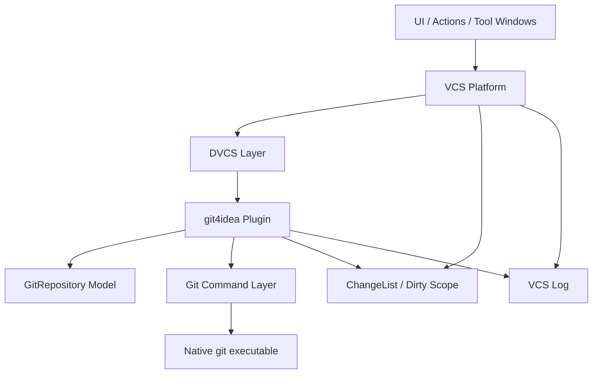
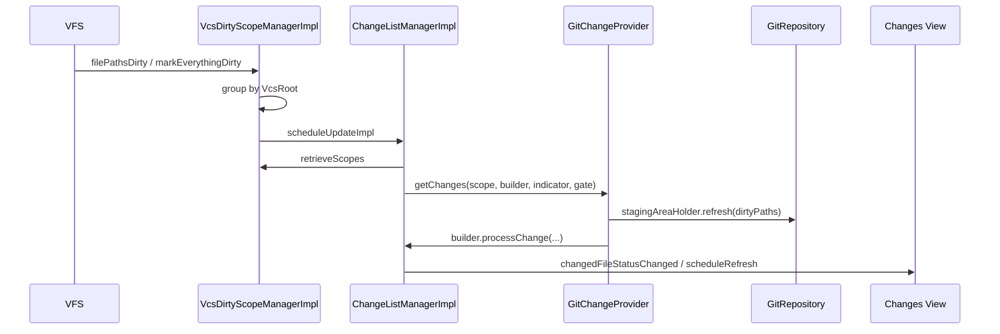
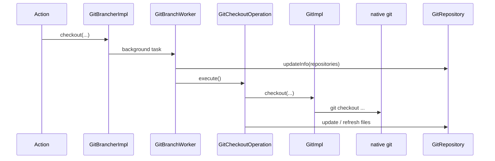
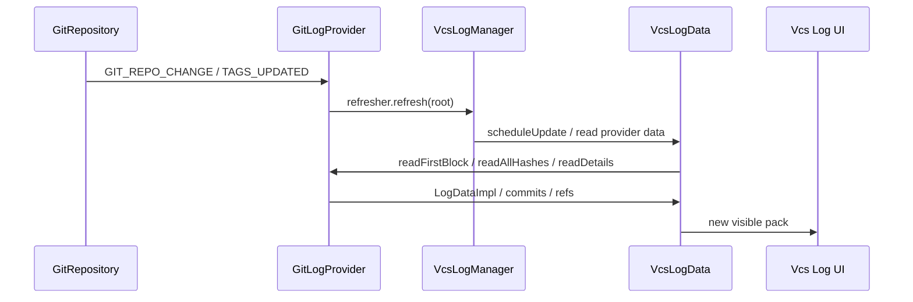

# IntelliJ Git Management Implementation Analysis

本文分析 IntelliJ IDEA Platform 中 Git 管理相关实现。范围包括通用 VCS 平台、DVCS 抽象层、`git4idea` Git 插件、VCS Log、变更列表、分支、更新、推送、命令执行和状态刷新等主干路径。

> 说明：本分析基于当前仓库源码阅读；当前会话中 `ijproxy` MCP 不可用，按 AGENTS 规则退回只读搜索与补丁写入。

## 1. 总体架构

Git 管理实现不是一个单体模块，而是由多层协作构成：

核心分层如下：

| 层级 | 代表路径 | 职责 |
| --- | --- | --- |
| VCS API | `platform/vcs-api` | VCS 抽象、目录映射、dirty scope、history、annotation、checkout 等基础接口 |
| VCS Impl | `platform/vcs-impl` | `ProjectLevelVcsManagerImpl`、`ChangeListManagerImpl`、dirty scope、Changes View、VCS Console |
| DVCS | `platform/dvcs-api`, `platform/dvcs-impl` | 多仓库、分支同步、push/cherry-pick、repository manager 等 DVCS 通用能力 |
| VCS Log | `platform/vcs-log` | 提交图、索引、过滤、刷新、Log UI |
| Git 插件 | `plugins/git4idea` | Git VCS 实现、命令封装、仓库模型、分支/update/push/log/status/checkin 等 |
| Shared/frontend | `plugins/git4idea/shared`, `plugins/git4idea/frontend` | Thin client/RPC、前端 widget 与共享数据模型 |

整体设计是“平台提供协议，Git 插件填充实现”。平台通过 extension point 和 service 注册发现 Git 能力，然后在各功能场景回调 Git 的 provider 或 service。

## 2. 插件注册与服务入口

Git 插件在 `plugins/git4idea/resources/intellij.vcs.git.xml` 中注册：

- `<vcs name="Git" vcsClass="git4idea.GitVcs" displayName="Git" administrativeAreaName=".git"/>`
- `<vcsRootChecker implementation="git4idea.roots.GitRootChecker"/>`
- `<vcsRepositoryCreator implementation="git4idea.repo.GitRepositoryCreator"/>`
- `<logProvider implementation="git4idea.log.GitLogProvider"/>`
- `<pushSupport implementation="git4idea.push.GitPushSupport"/>`
- 多个 checkin handler、changes refresher、ignored/unversioned/resolved holder、settings service、brancher、fetch support、Git command service 等。

通用 VCS 平台在 `platform/vcs-impl/resources/META-INF/VcsExtensions.xml` 注册核心服务：

- `ProjectLevelVcsManager -> ProjectLevelVcsManagerImpl`
- `ChangeListManager -> ChangeListManagerImpl`
- `VcsDirtyScopeManager -> VcsDirtyScopeManagerImpl`
- `AllVcsesI`, `FileStatusManager`, `ChangesViewI`, `LineStatusTrackerManagerI` 等。

DVCS 层在 `platform/dvcs-impl/resources/intellij.platform.vcs.dvcs.impl.xml` 注册：

- `vcsRepositoryCreator` 扩展点
- `VcsRepositoryManager` 启动活动
- push、branch、repository 相关通用能力。

VCS Log 在 `platform/vcs-log/impl/resources/intellij.platform.vcs.log.impl.xml` 注册：

- `logProvider` 扩展点
- `VcsProjectLog`
- `VcsLogObjectsFactory`
- `VcsUserRegistry`
- file history provider 等。

## 3. VCS 映射与仓库发现

`ProjectLevelVcsManagerImpl` 是项目级 VCS 映射中心，源码位于：

- `platform/vcs-impl/src/com/intellij/openapi/vcs/impl/ProjectLevelVcsManagerImpl.kt`

它负责：

- 保存 `VcsDirectoryMapping` 到 `vcs.xml`
- 根据文件或 `FilePath` 查找所属 `AbstractVcs`
- 根据文件查找 VCS root
- 激活当前项目中 active VCS
- 通过 `VcsRootChecker` 自动检测 `.git` 等 VCS root
- 维护 VCS Console 与 update info UI

Git root 检测由 Git 插件注册的 `GitRootChecker` 完成。发现 root 后，平台会把 root 映射到 Git VCS。

仓库对象管理由 DVCS 层 `VcsRepositoryManager` 负责：

- `platform/dvcs-impl/src/com/intellij/dvcs/repo/VcsRepositoryManager.kt`

它监听 `ProjectLevelVcsManager.VCS_CONFIGURATION_CHANGED`。当 VCS 映射改变时，它异步刷新 repository 集合。刷新流程：

1. 从 `ProjectLevelVcsManager.getAllVcsRoots()` 获取当前映射 root。
2. 通过 `vcsRepositoryCreator` extension point 找到匹配当前 VCS key 的 creator。
3. Git 对应 creator 创建 `GitRepository`。
4. 对无效 root dispose，对新增 root 创建并加入 map。
5. 发布 `VCS_REPOSITORY_MAPPING_UPDATED`。

Git 对 DVCS manager 进行窄化封装：

- `plugins/git4idea/src/git4idea/repo/GitRepositoryManager.java`

它继承 `AbstractRepositoryManager<GitRepository>`，提供 Git 类型安全的 `getRepositories()`，处理 Git 多 root 同步策略、submodule dependency 排序、ongoing rebase spec，并把仓库变化通过 Git 专用 topic 广播出去。

## 4. GitRepository 状态模型

Git 仓库对象的接口与实现位于：

- `plugins/git4idea/src/git4idea/repo/GitRepository.java`
- `plugins/git4idea/src/git4idea/repo/GitRepositoryImpl.kt`

`GitRepository` 是一个轻量、快速读取的仓库状态缓存。接口注释明确说明：普通 getter 不同步、不保证 100% 实时；需要强一致状态时调用 `update()`。

主要缓存内容包括：

- 当前分支：`currentBranch`
- 当前 revision：`currentRevision`
- 仓库状态：normal、rebasing、merging 等 `Repository.State`
- local/remote branches 与 hash
- remotes
- branch tracking info
- submodules
- hooks info
- shallow 状态
- staging area holder
- untracked/ignored files holder
- resolved merge conflicts holder
- tags holder
- working tree holder

`GitRepositoryImpl.update()` 在后台线程同步读取 `.git` 状态，核心读取逻辑在 `readRepoInfo()`：

- `GitConfig.read(...)` 读取 config
- `repositoryFiles.updateCustomPaths(...)` 处理 worktree/custom git dir
- `repositoryReader.readState(remotes)` 读取 HEAD、branches、state
- 解析 remotes、track infos、hooks、submodules、shallow
- 更新 recent checkout branches
- 构造新的 `GitRepoInfo`

仓库创建流程：

1. `GitRepositoryImpl.createInstance(root, project, parentDisposable)`
2. `GitUtil.findGitDir(root)` 定位 `.git` 目录或 worktree git dir
3. 初始化 staging/untracked/tags/working tree holder
4. 读取初始 `GitRepoInfo`
5. 安装 `GitRepositoryUpdater` 监听 `.git` service files
6. 发布 repository created/updated 事件
7. schedule tag reload，invalidate untracked/resolved holders

这个模型的关键设计点是：频繁 UI 查询走内存缓存，文件系统或 Git 操作导致的状态变化通过 `.git` 文件监听异步刷新。

## 5. GitVcs：平台能力适配器

`GitVcs` 位于：

- `plugins/git4idea/src/git4idea/GitVcs.java`

它继承 `AbstractVcs`，是 Git 插件接入 VCS 平台的主适配器。它提供：

- `CheckinEnvironment -> GitCheckinEnvironment`
- `RollbackEnvironment -> GitRollbackEnvironment`
- `UpdateEnvironment -> GitUpdateEnvironment`
- `ChangeProvider -> GitChangeProvider`
- `AnnotationProvider -> GitAnnotationProvider`
- `DiffProvider -> GitDiffProvider`
- `MergeProvider -> GitMergeProvider`
- `CommittedChangesProvider`
- `OutgoingChangesProvider`
- Git commit executor
- Git dirty scope builder
- forced commit mode/staging area commit mode

激活时 `activate()` 会：

- 创建 GitVcs coroutine scope
- 异步校验 Git executable version
- 创建 `GitVFSListener`
- 初始化 `VcsUserRegistry`
- 注册 annotation/advanced settings listener
- 激活 Git user registry
- 激活 incoming/outgoing branch manager

`GitVcs` 还持有一个项目级 `ReadWriteLock myCommandLock`，作为 Git 命令执行层的串行化机制。写操作命令会获取 write lock，避免多个可能修改 working tree/index/ref 的 Git 命令并发执行。

## 6. 命令执行层

命令执行层位于：

- `plugins/git4idea/src/git4idea/commands/Git.java`
- `plugins/git4idea/src/git4idea/commands/GitImpl.java`
- `plugins/git4idea/src/git4idea/commands/GitImplBase.java`
- `plugins/git4idea/src/git4idea/commands/GitHandler.java`
- `plugins/git4idea/src/git4idea/commands/GitLineHandler.java`

### 6.1 Git 接口

`Git` 是应用级 service 接口，封装常用 native git 命令：

- `init`, `clone`
- `checkout`, `branchCreate`, `branchDelete`, `renameBranch`
- `fetch`, `push`, `merge`, `rebase`, `reset`, `cherryPick`, `revert`
- `config`, `show`, `diff`, `lsRemote`
- untracked/ignored 查询
- worktree 操作

多数方法返回 `GitCommandResult`，上层业务不直接处理 process。

### 6.2 GitImpl

`GitImpl` 是命令构造层。它把业务方法翻译成 `GitLineHandler`：

- 设置 command：如 `GitCommand.CHECKOUT`
- 添加参数：如 `-b`, `--force`, `--porcelain`
- 设置 stdout/stderr 是否写入 VCS Console
- 为远程命令设置 URL，用于认证
- 添加 progress/listener
- 调 `runCommand(handler)`

例如 push 会构造 `git push --porcelain <remote> <spec>`，根据配置添加：

- `--progress`
- `--set-upstream`
- `--force-with-lease`
- `--force`
- tag mode
- `--no-verify`

### 6.3 GitImplBase

`GitImplBase` 是执行控制层，职责包括：

- Git executable 版本校验
- WSL unsupported version 检查
- HTTP/auth 失败时重试
- 准备 askpass、credential、general purpose editor、rebase editor
- 注入 Git trace 环境变量
- 可选设置 `GIT_OPTIONAL_LOCKS=0`
- 根据 `GitCommand.LockingPolicy` 决定是否拿 `GitVcs.getCommandLock().writeLock()`
- 输出收集与错误归类
- VCS Console 命令输出打印

命令锁的逻辑是：

- project 为空、default project 或无需写锁时不锁
- `READ` 命令不锁
- `READ_OPTIONAL_LOCKING` 且支持 `GIT_OPTIONAL_LOCKS=0` 时不锁
- 其他可能修改 Git 状态的命令拿 write lock

这个设计将 native Git 的可并发读能力与 IDE 内部状态一致性做了折中：读操作尽量并行，写操作串行。

### 6.4 GitHandler / GitLineHandler

`GitHandler` 负责底层 `GeneralCommandLine`：

- 设置工作目录、可执行文件、charset
- 默认传 `-c core.quotepath=false`
- 默认 `-c log.showSignature=false`
- unit test 下允许 `protocol.file.allow=always`
- flush pending VFS writes
- patch command line for local/WSL executable
- 构造环境变量，调用 `VcsEnvCustomizer`
- 启动 process 并处理输出
- telemetry span 记录 `git.command` 与 working directory

`GitLineHandler` 是按行处理 stdout/stderr 的 handler。它：

- 将 stdout/stderr 分行传给 `GitLineHandlerListener`
- 过滤 remote progress 的日志噪音
- 支持 remote URL、auth gate、auth mode
- 使用自定义 `LineReader` 避免普通 process reader 对 CR progress 行处理不够精细

## 7. 本地变更刷新链路

本地变更由平台 dirty scope 与 Git change provider 协作完成。

核心文件：

- `platform/vcs-impl/src/com/intellij/openapi/vcs/changes/VcsDirtyScopeManagerImpl.kt`
- `platform/vcs-impl/src/com/intellij/openapi/vcs/changes/ChangeListManagerImpl.java`
- `plugins/git4idea/src/git4idea/status/GitChangeProvider.java`

流程：

1. VFS listener、root/mapping/file type 变化等调用 `VcsDirtyScopeManager.markEverythingDirty()` 或 `filePathsDirty(...)`。
2. `VcsDirtyScopeManagerImpl` 按 `VcsRoot` 分组 dirty files/dirs，写入 `DirtBuilder`。
3. 如果 dirty scope ready，调用 `ChangeListManagerImpl.scheduleUpdateImpl()`。
4. `ChangeListManagerImpl.updateImmediately()` 取出 dirty scopes。
5. `iterateScopes(...)` 对每个 scope 构造 `UpdatingChangeListBuilder`。
6. `actualUpdate(...)` 获取 `scope.getVcs().getChangeProvider()`。
7. 对 Git root 调用 `GitChangeProvider.getChanges(...)`。
8. Git provider 刷新 staging area holder，收集 `GitFileStatus`，转换成 `Change`，通过 builder 写入 ChangeList model。
9. 未被 Git status 覆盖但文档未保存的 modified document，会由 `NonChangedHolder.feedBuilder(...)` 补成内存 modified change。

`GitChangeProvider` 的关键点：

- 用 `GitStagingAreaHolder.collectDirtyPathsPerRoot(...)` 处理 dirty scope 和 nested repo/submodule。
- 每个 root 调 `repo.getStagingAreaHolder().refresh(rootDirtyPaths)`。
- `GitChangesCollector.collect(...)` 将 Git status 记录转换为 IntelliJ `Change`。
- rename/move 跨 dirty scope 时会补充 dirty paths，触发下一轮刷新。
- submodule staging 状态变化可能要求刷新 parent repo 中对应 submodule path。
- refresh start/stop 和 repo updated 通过 `GitRefreshListener.TOPIC` 广播。

这条链路体现了 IntelliJ VCS 的基本模式：平台只知道 dirty scope 和 changelist，具体 VCS 负责把 dirty scope 转换成通用 `Change`。

## 8. 分支管理

主要文件：

- `plugins/git4idea/src/git4idea/branch/GitBrancher.java`
- `plugins/git4idea/src/git4idea/branch/GitBrancherImpl.java`
- `plugins/git4idea/src/git4idea/branch/GitBranchWorker.java`
- `plugins/git4idea/src/git4idea/branch/*Operation.java`

`GitBrancherImpl` 是 project service，对外提供分支操作 API，并将操作放入 background task。它负责 UI/background 边界：

- `checkoutNewBranch`
- `checkout`
- `createBranch`
- `deleteBranch`
- `merge`
- `rebase`
- `renameBranch`
- compare/diff UI

`GitBranchWorker` 运行在当前 background thread，负责真正的业务操作。它依赖：

- `Git` command service
- `GitBranchUiHandler`
- `GitVcs`
- operation 类，例如 `GitCheckoutOperation`、`GitCreateBranchOperation`、`GitDeleteBranchOperation`

分支操作通常先 `updateInfo(repositories)`，确保 repository cache 较新，再创建 operation 执行。多 root 场景下 operation 负责逐仓库执行、错误处理、rollback 提示和 UI 通知。

## 9. Update / Pull

主要文件：

- `plugins/git4idea/src/git4idea/update/GitUpdateEnvironment.java`
- `plugins/git4idea/src/git4idea/update/GitUpdateProcess.java`
- `plugins/git4idea/src/git4idea/update/GitUpdater.java`
- `GitMergeUpdater`, `GitRebaseUpdater`, `GitResetUpdater`, `GitSubmoduleUpdater`

`GitUpdateEnvironment` 实现平台 `UpdateEnvironment`，把 IDE 的 “Update Project” 接入 Git update process。

`GitUpdateProcess` 是多仓库 update 编排器：

- 检查是否有 unfinished merge/rebase/unmerged files
- 检查当前分支与 tracked branch
- 对需要更新的 remote 先 fetch
- 构建每个 repository 的 `GitUpdater`
- 根据同步策略和 submodule 情况选择 root
- 执行 update，并记录 skipped roots、updated ranges

`GitUpdater.getUpdater(...)` 根据 update method 选择：

- merge：`GitMergeUpdater`
- rebase：`GitRebaseUpdater`
- reset：`GitResetUpdater`

如果用户选择 “branch default”，会读取 Git config：

- `branch.<name>.rebase`
- `pull.rebase`

`GitUpdater.update()` 的通用流程：

1. `markStart()` 记录 update 前 `HEAD`
2. `doUpdate()` 由 merge/rebase/reset 子类实现
3. `repository.update()` 刷新仓库缓存
4. `markEnd()` 用 `MergeChangeCollector` 计算 update 后变更，填入 `UpdatedFiles`

## 10. Push

主要文件：

- `platform/dvcs-api/src/com/intellij/dvcs/push/*`
- `platform/dvcs-impl/src/com/intellij/dvcs/push/*`
- `plugins/git4idea/src/git4idea/push/GitPushSupport.kt`
- `plugins/git4idea/src/git4idea/push/GitPusher.kt`
- `plugins/git4idea/src/git4idea/push/GitPushOperation.*`

DVCS 平台定义 push support/pusher 抽象，Git 插件通过 `<pushSupport implementation="git4idea.push.GitPushSupport"/>` 接入。

`GitPusher` 继承 `Pusher<GitRepository, GitPushSource, GitPushTarget>`。入口方法接收：

- repo -> `PushSpec<GitPushSource, GitPushTarget>`
- additional option，如 tag mode、skip hook
- force 标记
- custom params

执行流程：

1. 过期已有错误/警告通知。
2. 解析 `GitVcsPushOptionValue`，保存 `pushTagMode`。
3. 创建 `GitPushOperation`。
4. 调 `pushOperation.execute()`。
5. 发布 `GitPushListener.TOPIC`。
6. 如果有 updated ranges，创建 log tab 展示 update info。
7. 收集 `GitPushNotificationCustomizer` action。
8. EDT 上创建并展示 `GitPushResultNotification`。

底层 push 仍由 `GitImpl.push(...)` 构造 native `git push` 命令，并支持 force-with-lease、tag mode、skip hooks 等。

## 11. VCS Log 与 GitLogProvider

VCS Log 的平台入口：

- `platform/vcs-log/impl/src/com/intellij/vcs/log/impl/VcsProjectLog.kt`
- `platform/vcs-log/impl/src/com/intellij/vcs/log/impl/VcsLogManager.kt`

Git provider：

- `plugins/git4idea/src/git4idea/log/GitLogProvider.kt`

`VcsProjectLog.getLogProviders(project)` 会从项目 VCS roots 中查找支持当前 VCS key 的 `VcsLogProvider`。Git 的 provider key 是 `GitVcs.getKey()`。

`GitLogProvider` 负责把 `git log` 数据转换成 VCS Log 数据结构：

- `readFirstBlock(...)` 读取初始提交块与 refs
- `readAllHashes(...)` 读取完整 hash 序列
- `readFullDetails(...)` 读取提交详情和 diff
- `readMetadata(...)` 读取元数据
- `getCommitsMatchingFilter(...)` 将 VCS Log filter 转成 git log 参数
- `subscribeToRootRefreshEvents(...)` 监听 Git repository/tags 更新并刷新 log
- `getCurrentUser(...)`、`getContainingBranches(...)`、`resolveReference(...)`
- 提供 `VcsLogIndexer`

`readFirstBlock(...)` 的性能设计值得注意：

- 初始参数用 `HEAD --branches --remotes --max-count=N*2`
- 默认不加 `--tags`，避免 tag 很多时显著变慢
- refresh refs 时手动读取 branches
- 对“新出现且只由 tag 指向”的 commit 单独补充读取
- 结果通过 `VcsLogSorter.sortByDateTopoOrder(...)` 排序并截断
- debug 下校验 refs/commits 一致性

`VcsLogManager` 负责 UI 与数据管理：

- 找 log providers
- 创建 `VcsLogDataImpl`
- 创建 main log UI 和附加 log tab
- 处理 refresh 请求
- 根据 log 是否可见或 keep-up-to-date 策略决定是否 postpone refresh
- 存储/index 失败时标记 corrupted 并重建

## 12. Checkin / Commit

Git commit 能力由 `GitVcs.getCheckinEnvironment()` 返回：

- `plugins/git4idea/src/git4idea/checkin/GitCheckinEnvironment.kt`

平台 commit 由 changelist/commit subsystem 驱动，Git 插件提供 checkin environment 和多个 checkin handler：

- username 检查
- CRLF 检查
- large file 检查
- detached root 检查
- filename 检查
- rebase/cherry-pick continue 相关 handler
- commit message provider / merge commit message policy

Git 还通过 `GitVcs.getForcedCommitMode(...)` 支持 staging area commit mode：当 non-modal commit 且 Git staging area enabled 时，返回 `GitStagingAreaCommitMode`。

## 13. 并发、缓存与一致性

Git 管理实现中的并发设计主要有四类：

### 13.1 Git 命令锁

`GitVcs` 提供项目级 `ReadWriteLock`，`GitImplBase` 根据命令类型决定是否拿 write lock。这样避免 checkout/rebase/merge/push 等命令同时修改 index/ref/working tree。

### 13.2 Repository cache 异步刷新

`GitRepository` getter 快速但可能略旧；`.git` 文件变化由 `GitRepositoryUpdater` 触发异步 `update()`。需要强一致状态的业务会显式调用 `repository.update()`。

### 13.3 Dirty scope 增量刷新

`VcsDirtyScopeManagerImpl` 聚合变更，`ChangeListManagerImpl` 取 snapshot 处理，处理期间新 dirty scope 会进入下一轮。Git provider 对跨 scope rename/submodule 状态变化也会补脏路径。

### 13.4 VCS Log 延迟刷新

`VcsLogManager` 根据 UI 可见性与 registry `vcs.log.keep.up.to.date` 决定立即刷新或 postpone。GitLogProvider 监听 repository 和 tags 变化后请求 root refresh。

## 14. 扩展点与可替换点

Git 管理实现大量依赖 IntelliJ extension point：

| 扩展点 | 用途 |
| --- | --- |
| `vcs` | 注册 `GitVcs` |
| `vcsRootChecker` | 检测 `.git` root |
| `vcsRepositoryCreator` | 根据 root 创建 `GitRepository` |
| `logProvider` | 接入 VCS Log |
| `pushSupport` | 接入 DVCS Push UI |
| `vcsCheckinHandlerFactory` | commit 前检查与流程增强 |
| `vcsChangesViewRefresher` | Changes View 刷新 |
| `vcs.ignoredFilesHolder` / `vcs.unversionedFilesHolder` | VCS managed files holder |
| `vcs.updateOptionsDialogProvider` | update options UI |
| `vcs.commitMessageProvider` | commit message 来源 |
| `vcs.diffRevisionMetadataProvider` | diff revision metadata |
| `VcsEnvCustomizer.EP_NAME` | 定制 Git process environment |
| `GitPushNotificationCustomizer.EP_NAME` | 自定义 push 完成通知 action |

## 15. 典型调用链

### 15.1 文件修改到 Changes View

### 15.2 Branch checkout

### 15.3 Log refresh

## 16. 设计评价

### 优点

- 分层清晰：平台抽象、DVCS 通用逻辑、Git 实现、UI/log 各自边界明确。
- 性能友好：仓库状态缓存、dirty scope 增量刷新、log 首屏读取避免 tags、大输出命令支持不收集 stdout。
- 多 root 支持深入：repository manager、branch sync、update process、push specs、submodule dependency 排序都有多仓库意识。
- 与 native Git 兼容：大多数操作最终由真实 `git` 命令执行，IDE 主要负责 orchestration、UI、缓存和错误处理。
- 扩展性强：provider/service/EP 体系允许 GitHub/GitLab、commit handler、push notification、env customizer 等独立扩展。

### 代价与复杂度

- 状态一致性是 eventually consistent：`GitRepository` getter 快，但可能不是最新；调用方必须知道何时 `update()`。
- 异步链路长：VFS -> dirty scope -> changelist -> provider -> holder -> UI，排查刷新问题需要跨多层。
- 命令执行层承担很多横切逻辑：auth、editor、locks、trace、console、env、WSL，维护成本较高。
- 多 root/submodule/worktree 使边界复杂：parent/submodule dirty scope、worktree git dir、dependency order 都需要特殊处理。
- VCS Log 为性能做了很多启发式策略，比如初始不读 tags，需要额外补偿逻辑保证 refs 一致。

## 17. 关键源码索引

| 功能 | 文件 |
| --- | --- |
| Git VCS adapter | `plugins/git4idea/src/git4idea/GitVcs.java` |
| Git command API | `plugins/git4idea/src/git4idea/commands/Git.java` |
| Git command implementation | `plugins/git4idea/src/git4idea/commands/GitImpl.java` |
| Git command execution base | `plugins/git4idea/src/git4idea/commands/GitImplBase.java` |
| Process handler | `plugins/git4idea/src/git4idea/commands/GitHandler.java` |
| Line process handler | `plugins/git4idea/src/git4idea/commands/GitLineHandler.java` |
| Repository interface | `plugins/git4idea/src/git4idea/repo/GitRepository.java` |
| Repository implementation | `plugins/git4idea/src/git4idea/repo/GitRepositoryImpl.kt` |
| Git repository manager | `plugins/git4idea/src/git4idea/repo/GitRepositoryManager.java` |
| DVCS repository manager | `platform/dvcs-impl/src/com/intellij/dvcs/repo/VcsRepositoryManager.kt` |
| Project VCS mapping | `platform/vcs-impl/src/com/intellij/openapi/vcs/impl/ProjectLevelVcsManagerImpl.kt` |
| Dirty scope manager | `platform/vcs-impl/src/com/intellij/openapi/vcs/changes/VcsDirtyScopeManagerImpl.kt` |
| Change list manager | `platform/vcs-impl/src/com/intellij/openapi/vcs/changes/ChangeListManagerImpl.java` |
| Git change provider | `plugins/git4idea/src/git4idea/status/GitChangeProvider.java` |
| Brancher | `plugins/git4idea/src/git4idea/branch/GitBrancherImpl.java` |
| Branch worker | `plugins/git4idea/src/git4idea/branch/GitBranchWorker.java` |
| Update environment | `plugins/git4idea/src/git4idea/update/GitUpdateEnvironment.java` |
| Update process | `plugins/git4idea/src/git4idea/update/GitUpdateProcess.java` |
| Single-repo updater | `plugins/git4idea/src/git4idea/update/GitUpdater.java` |
| Push | `plugins/git4idea/src/git4idea/push/GitPusher.kt` |
| Git log provider | `plugins/git4idea/src/git4idea/log/GitLogProvider.kt` |
| VCS project log | `platform/vcs-log/impl/src/com/intellij/vcs/log/impl/VcsProjectLog.kt` |
| VCS log manager | `platform/vcs-log/impl/src/com/intellij/vcs/log/impl/VcsLogManager.kt` |

## 18. 总结

IntelliJ 的 Git 管理实现本质上是“native Git + IDE 状态模型 + 平台扩展体系”的组合。Git 插件不重写 Git 的版本控制算法，而是把 native Git 命令包装成可取消、可认证、可记录、可串行化、可被 UI 消费的 IDE 操作。

架构上的核心资产是：

- `ProjectLevelVcsManagerImpl` 管映射
- `VcsRepositoryManager` 管 repository 生命周期
- `GitRepository` 管 Git 状态缓存
- `GitImplBase/GitHandler` 管 native command execution
- `VcsDirtyScopeManagerImpl + ChangeListManagerImpl + GitChangeProvider` 管本地变更
- `VcsProjectLog/VcsLogManager + GitLogProvider` 管提交历史
- `GitBrancher/GitUpdateProcess/GitPusher` 管高层 Git workflow

这些组件通过 message bus、extension point、service 和 dirty scope 连接起来，形成一个可扩展但复杂的 Git 管理系统。
